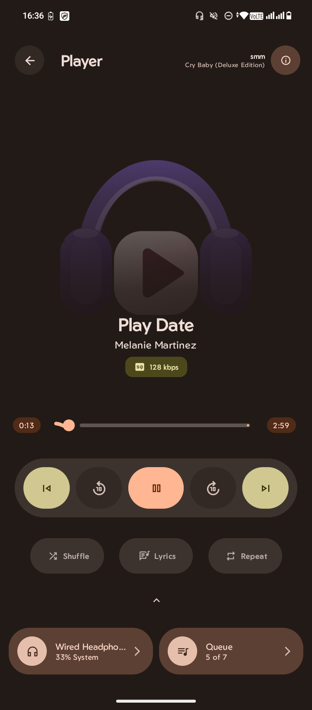

# My Player 2

An Android music player built with Kotlin. The project is still in development, so features and the interface may change.

## Screenshot



## About

My Player 2 is a personal music player project. The current interface includes playback controls, shuffle and repeat options, lyrics, and a queue view.

## Getting started

### Requirements

- Android Studio
- Android SDK
- JDK version required by the project’s Gradle configuration

### Run the app

1. Clone the repository:
   ```bash
   git clone https://github.com/raiprajwal685-beep/my-player-2.git
   ```
2. Open the project in Android Studio.
3. Allow Gradle to sync, then run the `app` configuration on an emulator or Android device.

You can also build a debug APK from the repository root with:

```bash
./gradlew assembleDebug
```

On Windows, use:

```bat
gradlew.bat assembleDebug
```

## Contributing

Contributions and suggestions are welcome. To propose a change:

1. Fork the repository.
2. Create a branch for your change.
3. Make and test your changes.
4. Open a pull request describing what you changed.

For larger changes, please open an issue first to discuss the idea.

## License

This project is licensed under the **GNU General Public License v3.0**. See [`LICENSE`](LICENSE) for the full license text.

## Contact

For questions, feedback, or bug reports, open a [GitHub issue](https://github.com/raiprajwal685-beep/my-player-2/issues) or contact [@raiprajwal685-beep](https://github.com/raiprajwal685-beep).
